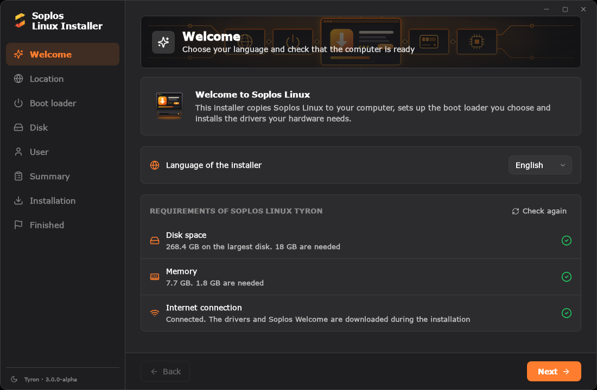
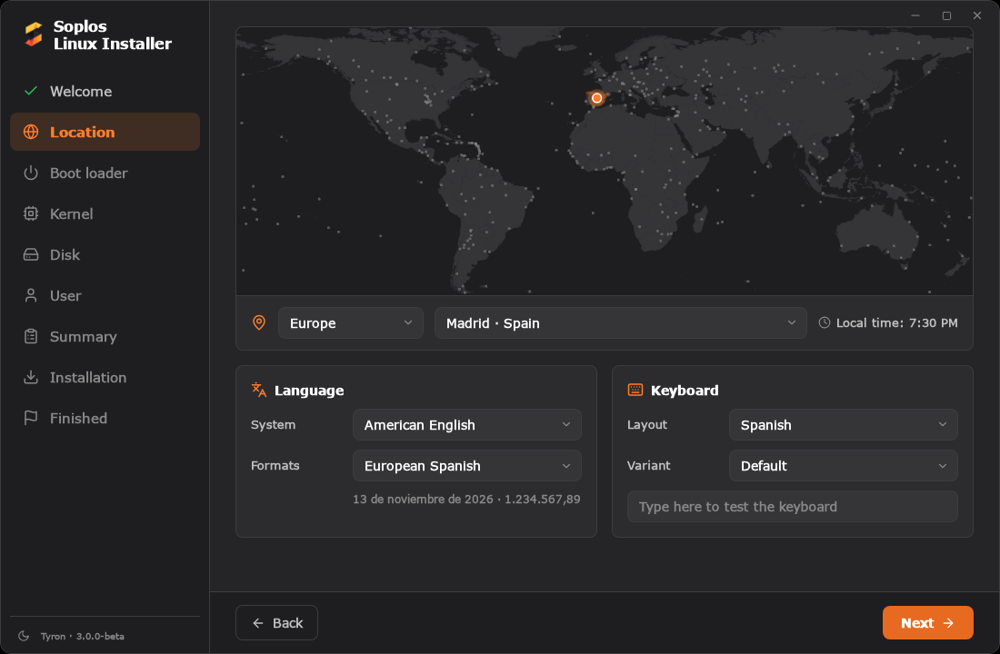
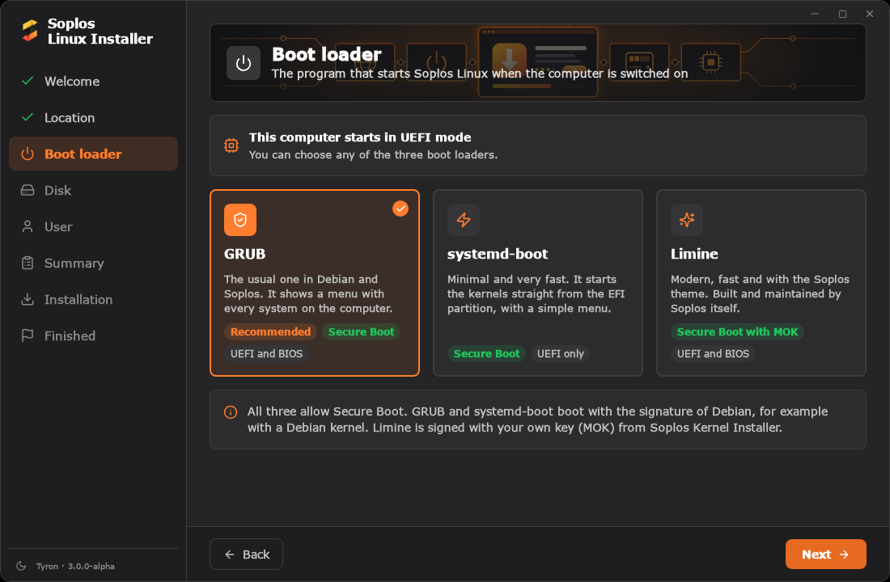
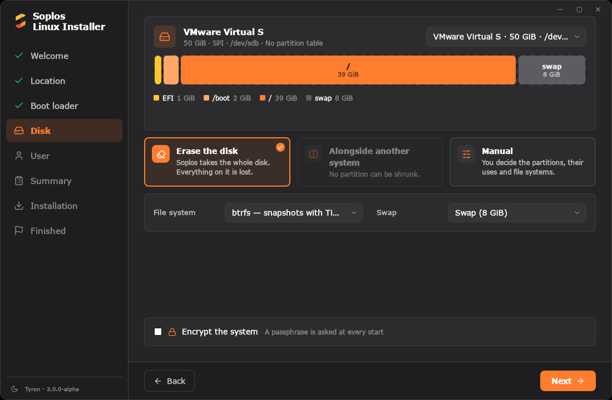
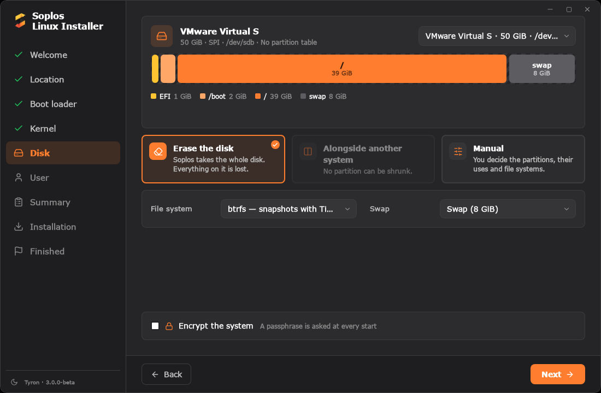
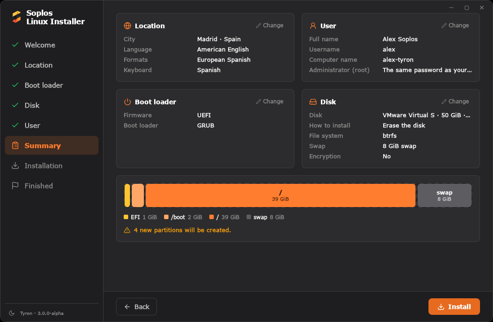
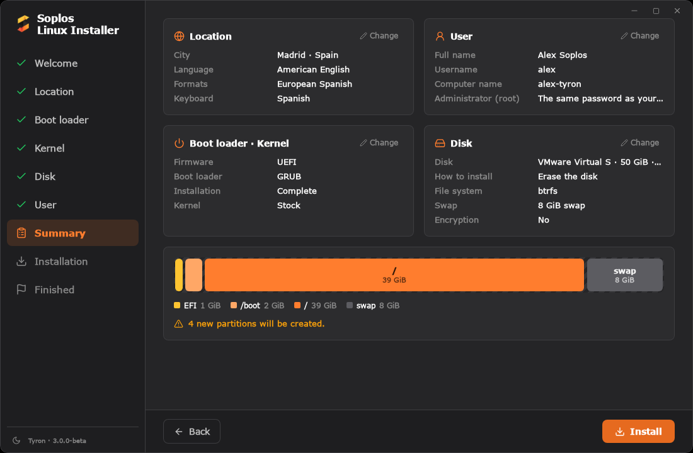
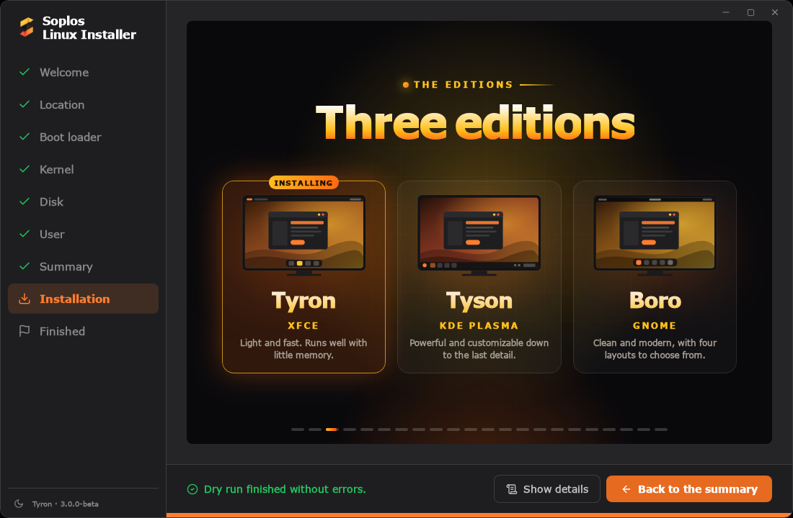
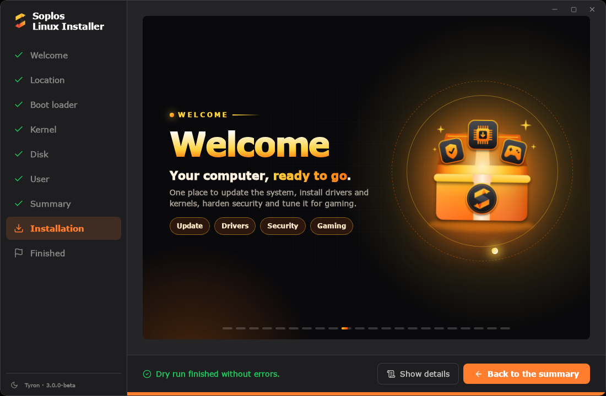

# Soplos Linux Installer 3.0


The installer of Soplos Linux, for Tyron (Xfce), Tyson (Plasma) and Boro
(GNOME). It replaces Calamares.

|  Welcome: the language of the installer and the requirements of the edition |  Location: the map, the language, the formats and the keyboard |
|:---:|:---:|
|  Boot loader: GRUB, systemd-boot or Limine |  Kernel: the kind of installation and the Soplos kernel for the processor |
|  Disk: the disk as it will be, before anything is touched |  User: the account, the computer name and the passwords |
|  Summary: everything chosen, and what will be done to the disk |  Installation: the presentation of the three editions |
|  Installation: the programs of Soplos, one by one | |

## Status

Beta. Every step of the window is written, and the helper installs the
system: partitions, encryption, the copy of the system, its configuration,
the user, the packages, the drivers and the boot loader. The complete
design is in [DESIGN.md](DESIGN.md).

To check a plan without touching any disk, start it as a dry run: the
helper lists the commands it would run.

```bash
SLI_DRY_RUN=1 npm run tauri dev
```

## Keyboard

The installer can be used without the mouse, as Calamares.

- **Alt + the underlined letter** presses a button. Holding Alt underlines
  one letter of each button; the letters come from the labels in the
  language chosen (for example *Next* and *Back*, or *Siguiente* and *Atrás*).
- **Alt+Right / Alt+Left:** next / back.
- **Alt+1 … Alt+7:** a step already reached.
- **Tab / Shift+Tab** move between the fields; **Space** or **Enter** press
  the button or option in focus.
- **Enter / Escape** accept or cancel a dialog.
- **F1:** about. **Ctrl+Q:** quit (not while the installation runs).

## Features

- **Boot loader of your choice:** GRUB, systemd-boot or Limine on UEFI, GRUB
  or Limine on BIOS, with the partitions each one needs.
- **Kind of installation and kernel:** minimal (the image as it is),
  standard (drivers and the kernel chosen) or complete (and the system
  brought up to date); the Soplos kernels for the level of the processor:
  stock, BORE + NTsync, Zen, RT or X3D, latest or LTS.
- **Disk:** erase the disk, install alongside another system, or manual
  partitioning; btrfs (with the `@` and `@home` subvolumes Timeshift uses),
  ext4 or xfs; optional encryption; swap. Manual partitioning offers the
  mount points of Calamares (`/`, `/boot`, `/home`, `/opt`, `/srv`, `/usr`,
  `/var`) and mount points of data of your own, with btrfs, ext4, xfs, F2FS
  and JFS for the system and also exFAT, NTFS and FAT32 for data. A partition
  of data can be kept as it is and is written in the fstab with `nofail`.
- **Drivers for the hardware:** the hardware is detected as Soplos Welcome
  does, and during the installation the missing drivers are installed and
  the ones that do not apply are removed.
- **A presentation of Soplos Linux** while the system is installed.
- **Eight languages:** English, Spanish, German, French, Italian, Portuguese,
  Romanian and Russian.

## Architecture

The same stack as the other 3.0 programs: a Rust backend and a Svelte 4 +
Tailwind CSS frontend, rendered through the system's WebKitGTK.

- The window runs as the live user and never as root.
- The disk work is done by the same binary in helper mode
  (`soplos-linux-installer --helper`), started with `sudo -n`. It receives the
  installation plan as JSON and reports its progress as JSON lines.

## Build

```bash
npm install
npm run tauri icon ../soplos-artwork/soplos-linux-installer/soplos-linux-installer.png
npm run tauri dev       # development
./package.sh            # builds the .deb and copies it to Descargas and MEGA
```

## Project layout

```
src/                     Svelte interface (App, steps, i18n)
src/presentation/        the presentation shown while installing, with its texts
src-tauri/src/commands/  Rust: commands for the window
src-tauri/src/helper/    Rust: the installation (plan, disk, system)
src-tauri/resources/     desktop file, copyright and the data of each edition
DESIGN.md                the design of the installer
```

## License

GPL-3.0-or-later. Copyright 2026 Sergi Perich.

## Support

- Website: https://soplos.org
- Issues: https://github.com/SoplosLinux/soplos-linux-installer-3.0/issues
